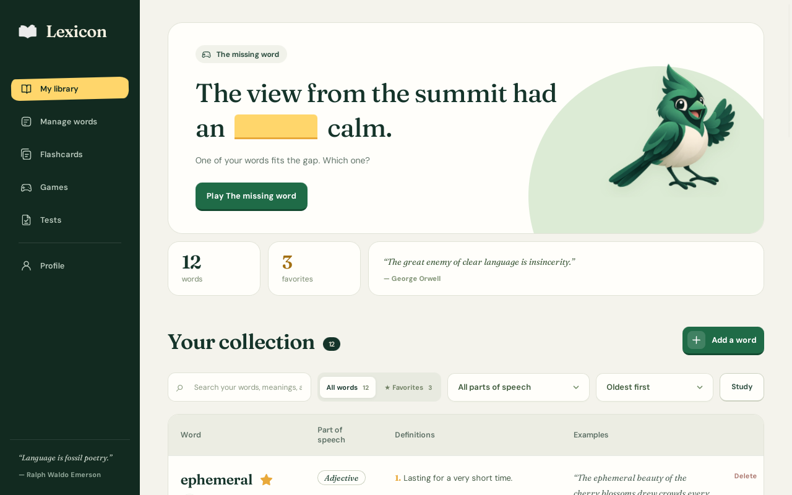
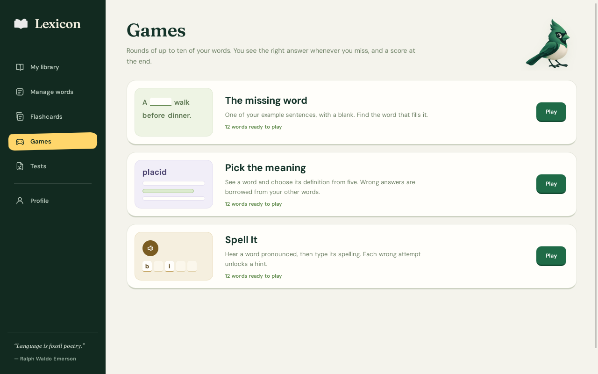
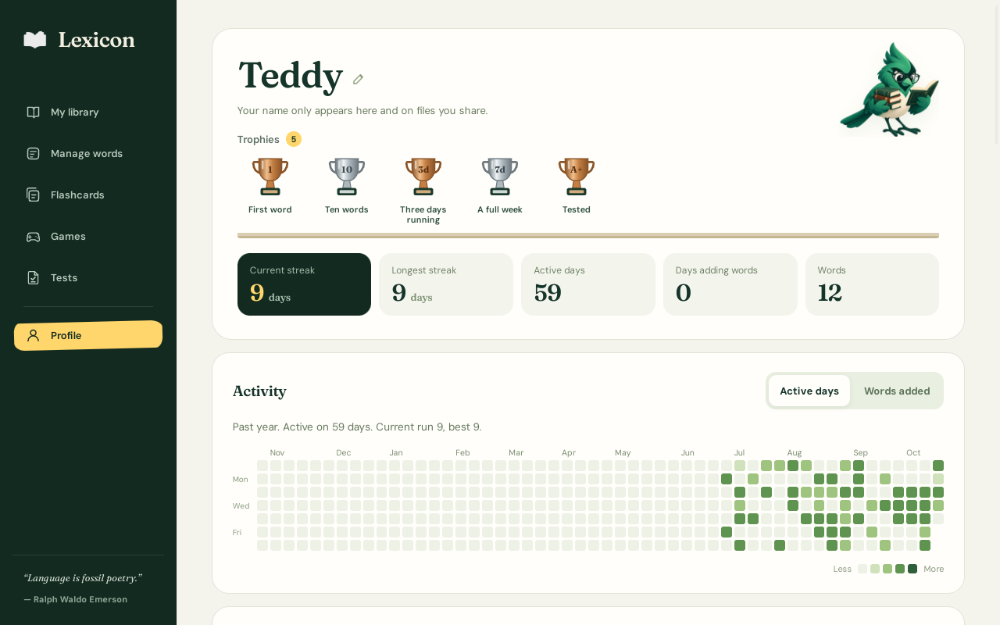

<p align="center"></p>

<h1 align="center">Lexicon</h1>

<p align="center">A personal vocabulary app for macOS and Windows.<br>Collect the words you love, then learn them through flashcards, games and tests.</p>

<p align="center"><a href="../../releases/latest"><b>Download the latest version</b></a> · <a href="INSTALL.md">How to install</a></p>



I made Lexicon on my lunch break for fun, to help my friends and me improve our vocabulary. It's free, there's no account, and nothing leaves your computer. Once it's installed it works without an internet connection.

## What it does

- **Your library.** Words with numbered definitions and lettered subdefinitions (1, 2a, 2b), each with its own example sentences, synonyms, antonyms and related forms, part of speech, IPA and a readable American pronunciation, synonyms, antonyms and related forms, with optional Merriam-Webster links.
- **Flashcards** from all your words or just your favorites.
- **Games.** *The missing word* fills a blank in your own example sentences, *Pick the meaning* finds the right definition among five, and *Spell It* says a word aloud for you to spell.
- **Tests** with multiple choice, written and true-or-false questions, graded A+ to F.
- **Profile** with streaks, a year-long activity calendar, trophies and a log of the words you've added.
- **Sharing.** Send your words to a friend as a file; they add the ones they want.

| Games | Profile |
| --- | --- |
|  |  |

## Install

| | |
| --- | --- |
| **Mac** | macOS 13 Ventura or newer, Apple chip or Intel. Download `Lexicon_<version>_universal.dmg`. |
| **Windows** | Windows 10 or 11 (64-bit). Download `Lexicon_<version>_x64-setup.exe`. |

Both are on the [latest release](../../releases/latest) page. **[INSTALL.md](INSTALL.md)** has step-by-step instructions, including how to get past the warning your computer shows the first time (see [Unsigned installers](#unsigned-installers)).

**Updating:** download the new version and install it over the old one. Your words are stored separately from the app and are never touched by an update.

## Your data

Everything lives in two files, `vocabulary.json` and `profile.json`, in your computer's app-data folder:

| | |
| --- | --- |
| Mac | `~/Library/Application Support/io.github.teddyfitzsimons.lexicon/` |
| Windows | `%APPDATA%\io.github.teddyfitzsimons.lexicon\` |

**Profile → Show data folder** opens it. Each save is written safely (a crash can't leave a half-written file), and the previous version is kept as `vocabulary.json.bak` and `profile.json.bak`.

**Backing up:** **Profile → Back up…** saves your whole library and your streaks in one file. **Restore from backup** brings it back, on this computer or a new one. Restoring asks first, and a copy of what it replaced goes into `snapshots/` in the data folder (the last 10 are kept).

**Coming from the web version?** Choose **Restore from backup** and select `vocabulary.json` and `profile.json` together from your old `data` folder. Favorites, dates added and streaks all come across.

Uninstalling leaves the data folder in place. Delete it yourself to erase everything.

## Pronunciation audio

Audio uses the voices installed on your computer, so quality varies. On a Mac, add voices in **System Settings → Accessibility → Spoken Content → System Voice → Manage Voices**. On Windows, use **Settings → Time & language → Speech → Add voices**. Lexicon prefers voices installed on the device, which work offline. If the only US English voice on Windows is an online "Natural" voice, audio needs an internet connection.

## Unsigned installers

Lexicon is a free hobby project, so the installers aren't signed with a paid Apple or Microsoft certificate.

- **macOS** says it can't verify the app the first time you open it. Click **Done**, then **System Settings → Privacy & Security → Open Anyway**. You may need to do this again after each update.
- **Windows** SmartScreen shows *Windows protected your PC*. Click **More info → Run anyway**. Your browser may also ask whether to keep the download.

These warnings are your computer working as intended. Lexicon never asks you to turn security features off. If you want to be sure a download hasn't been tampered with, compare it against `SHA256SUMS.txt` on the release page.

## Privacy

No accounts, analytics, tracking or update checks. Lexicon only goes online when you click a Merriam-Webster link (in your browser) or if your computer's speech voice is an online one. The app window can only reach its own two data files, save files to a place you choose, and open Merriam-Webster pages; it has no other file, network or system access.

## Reporting a bug

[Open an issue](../../issues) with your operating system, what you did, and what happened. A screenshot helps. Please don't attach your backup file unless you're happy for others to see your words.

## Building from source

You need [Node.js](https://nodejs.org) 22, [Rust](https://rustup.rs) (stable), and the [Tauri prerequisites](https://v2.tauri.app/start/prerequisites/) for your system (Xcode Command Line Tools on macOS; Microsoft C++ Build Tools and WebView2 on Windows).

```bash
npm install
npm test                 # frontend tests
npm run tauri dev        # the desktop app with live reload
npm run tauri build      # installers for the current system
```

`npm run tauri build` puts the macOS `.app` and `.dmg` in `src-tauri/target/release/bundle/`. For one `.dmg` that runs on both Apple chips and Intel:

```bash
rustup target add aarch64-apple-darwin x86_64-apple-darwin
npm run tauri build -- --target universal-apple-darwin --bundles app,dmg
```

A build made on your own Mac opens without the Gatekeeper warning, because it wasn't downloaded.

`npm run dev` still runs the browser version against `data/*.json`, which is handy for working on the interface.

### Tests

| | |
| --- | --- |
| `npm test` | Game logic, tests, streaks, sharing, backup and restore |
| `cd src-tauri && cargo test` | Storage: atomic saves, validation, backups, snapshots |
| `e2e/run.py` | Drives the real app end to end (Linux only; see the file) |

CI runs the Rust tests on macOS, Windows and Linux, plus the end-to-end test, on every push.

### Releasing

1. Update `version` in `package.json` and add a `## <version>` section to `CHANGELOG.md`.
2. Commit, then tag and push: `git tag v2.2.0 && git push origin v2.2.0`.
3. The **Release** workflow builds both installers and creates a **draft** release with checksums and notes from the changelog.
4. Download and try the installers from the draft, then press **Publish**.

To test the build without a release, run the **Release** workflow by hand from the Actions tab; the installers appear as downloadable artifacts.

### Project layout

| | |
| --- | --- |
| `src/` | The React interface (unchanged from the web version except storage, file saving and links) |
| `src/lib/platform.ts` | The only place that knows whether it's running as the desktop app or in a browser |
| `src/lib/storage.ts` | Loads and saves the two documents |
| `src/lib/backup.ts` | Backup file format and restore checks |
| `src-tauri/src/store.rs` | Writes the documents to disk safely, validates them, keeps backups |
| `src-tauri/src/lib.rs` | App setup and the commands the window may call |
| `src-tauri/capabilities/main.json` | Everything the window is allowed to do |
| `docs/web-version-notes.md` | Design and feature notes from the web version |

## License

[MIT](LICENSE) © 2026 Teddy Fitzsimons. Fraunces and DM Sans are under the SIL Open Font License (`src/assets/fonts/`).
